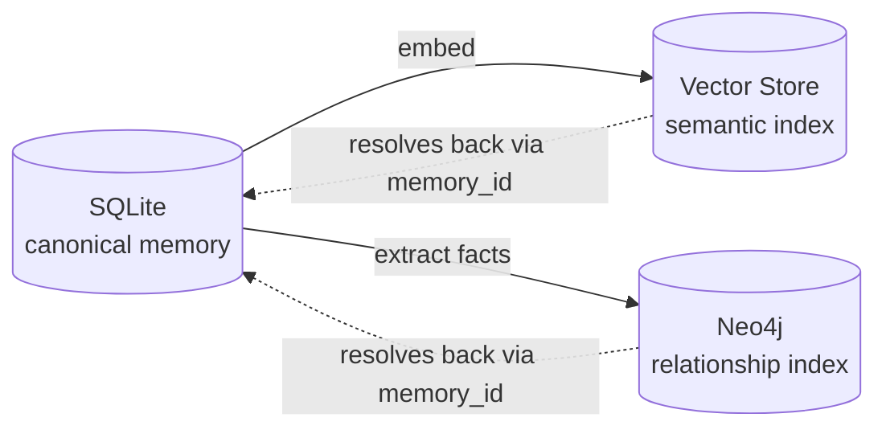

# Architecture

## Three storage layers, one source of truth

SQLite is the only place a memory's content actually lives. The vector store and the graph are **derived representations** — every entry in either one carries the `memory_id` of the SQLite row it came from, and retrieval always resolves back to that canonical row rather than trusting the index's own copy of the text.

This matters for the adaptive design: a vector backend or an embeddings model can be swapped out and rebuilt from SQLite at any time, because SQLite was never dependent on them in the first place.

## Component map

| Module | Responsibility |
|---|---|
| `memory.py` | Public API (`Memory`) — orchestrates everything below |
| `store.py` | SQLite persistence: messages, summaries, canonical memories |
| `vector_store.py` | Thin adapter around any LangChain `VectorStore` |
| `graph_store.py` | `GraphStore` abstract base + `Neo4jGraphStore` implementation |
| `extractor.py` | LLM-based extraction of candidate memories from a conversation turn |
| `updater.py` | LLM-based `ADD` / `UPDATE` / `DELETE` / `NOOP` resolution |
| `retriever.py` | Vector search → resolves hits back to canonical `MemoryItem`s |
| `router.py` | Decides whether graph retrieval is worth the extra round trip |
| `graph_extractor.py` | Converts a canonical memory into subject–relation–object facts |
| `summarizer.py` | Maintains a running per-conversation summary |
| `llm.py` | `LLMClient` — normalizes `BaseChatModel.invoke()` output to a string |
| `types.py` | Shared dataclasses: `Message`, `CandidateMemory`, `MemoryItem`, `MemoryUpdate`, `RetrievalDecision`, `GraphFact` |

## Why three adapters, not one integration

Each adapter point exists because a different part of the system has a different natural variability:

**Model adapter (`LLMClient` / `BaseChatModel`)**
Extraction, update resolution, summarization, routing, and graph extraction all need an LLM call, but they don't need to be the *same* LLM call. `Memory` accepts one `LLMClient` and one `chat_model` — in practice these are usually the same underlying model, but nothing stops an application from running its main agent on one provider and memlib's internal reasoning on a cheaper one, since the only contract is LangChain's `BaseChatModel` interface.

**Storage adapter (`MemoryVectorStore` / `VectorStore`)**
`MemoryVectorStore` is a ~40-line wrapper around LangChain's `VectorStore` base class. It adds exactly one thing LangChain doesn't give you for free: tagging every document with `memory_id` and `user_id` so retrieval hits can be resolved back to SQLite and filtered per user. Chroma, FAISS, Pinecone, or anything else LangChain supports drops in without touching memlib's internals.

**Graph adapter (`GraphStore` / `Neo4jGraphStore`)**
Unlike the other two, this one is optional by construction: `Memory.__init__` only builds a `MemoryRouter` and `GraphExtractor` `if graph_store is not None`. An application that doesn't pass a `graph_store` never pays for graph extraction LLM calls or Neo4j round trips — `get_context()` and `add()` silently skip every graph-related step.

## Design invariant: memory_id provenance

Every derived record — a vector document, a graph relationship — carries the `memory_id` of its canonical SQLite row. This is what makes `UPDATE` and `DELETE` safe:

- **`UPDATE`** replaces the SQLite row in place (same `memory_id`), deletes and re-adds the vector embedding, deletes the old graph relationships for that `memory_id`, and re-extracts fresh ones.
- **`DELETE`** removes the row from SQLite, the embedding from the vector store, and every graph relationship tagged with that `memory_id` — in that order.

No storage layer is the implicit owner of the data; SQLite is the explicit owner, and everything else is kept consistent with it through the shared ID.

See [Memory Lifecycle](memory-lifecycle.md) for the full `add()` / `get_context()` call sequence.
