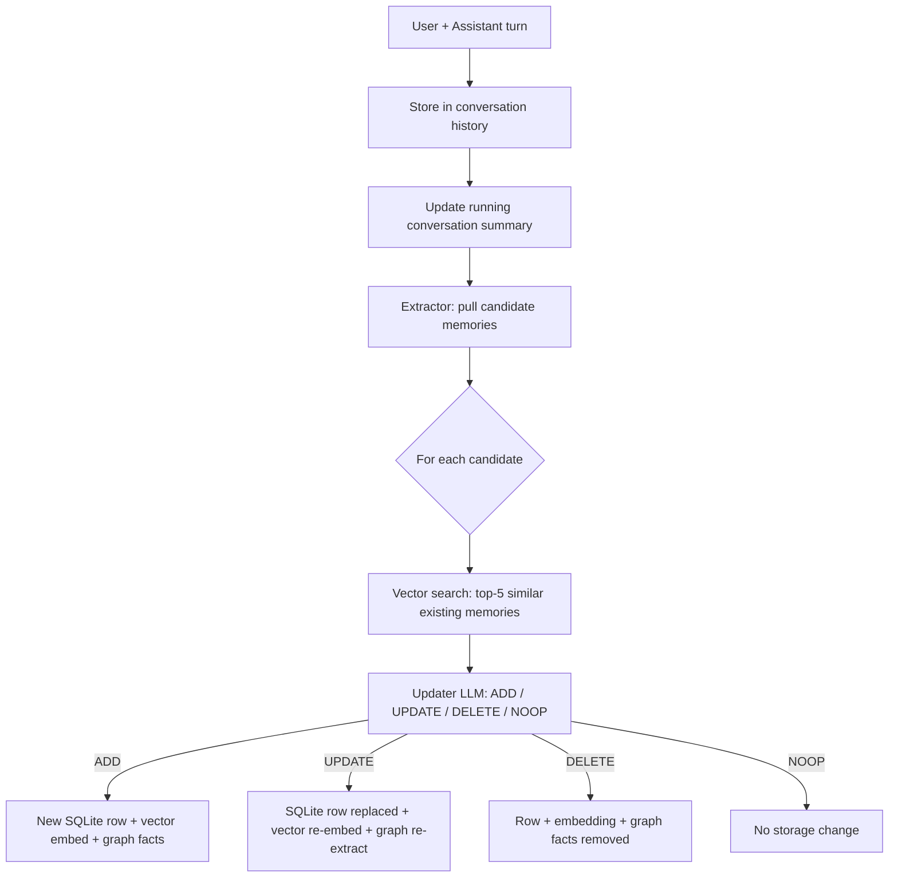
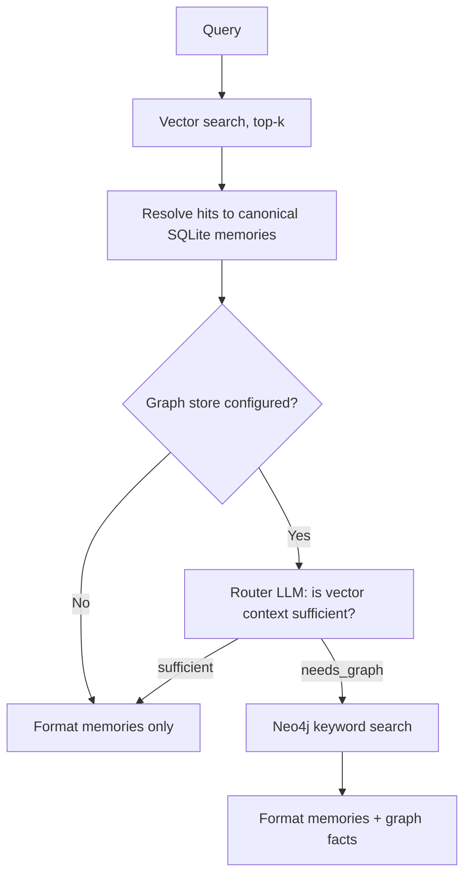

# **Memory Lifecycle**

## `memory.add(user_message, assistant_response)`

Each conversation turn can surface zero, one, or several candidate memories — the extractor isn't limited to one fact per turn. Each candidate is resolved **independently** against its own top-5 similar memories, so one turn can simultaneously add a new fact, update an existing one, and no-op on a third.

### Why resolution happens per-candidate, not per-turn

Resolving the whole turn against one shared memory set would let an unrelated existing memory "absorb" an edit it shouldn't, or miss a genuine duplicate because it was crowded out by a different candidate's neighbors. Giving each candidate its own retrieval + decision keeps the ADD/UPDATE/DELETE call well-scoped: the updater LLM only ever sees the candidate it's judging and the memories actually similar to *that* candidate.

### The four operations

| Operation | SQLite | Vector store | Graph |
|---|---|---|---|
| `ADD` | new row (`memory_id = uuid4()`) | new embedding | facts extracted from new content |
| `UPDATE` | row content replaced, same `memory_id` | old embedding deleted, new one added | old facts for that `memory_id` deleted, re-extracted |
| `DELETE` | row removed | embedding removed | facts for that `memory_id` removed |
| `NOOP` | — | — | — |

`NOOP` exists specifically to prevent duplicate memories — if the updater decides the candidate is already represented by an existing memory, nothing is written.

## `memory.get_context(query, limit=5, graph_limit=10)`

Graph retrieval is **conditional**, not automatic. The `MemoryRouter` sees the query and the memories already retrieved, and only triggers a Neo4j round trip when it decides relational context would actually help — avoiding the latency and token cost of a graph query on every single turn, even when a graph store is configured.

## `memory.search(query, limit=5)`

The lower-level primitive behind `get_context()`: runs the vector search, resolves hits back to `MemoryItem`s, and returns them directly — no graph routing, no formatting. Useful when an application wants the raw memory objects rather than a prompt-ready string.

## `memory.delete(memory_id)` / `memory.clear()`

`delete()` removes one memory's SQLite row, vector embedding, and (if configured) graph relationships, in that order. `clear()` does the same for every memory belonging to the current `user_id` — vector embeddings and graph relationships are removed before the SQLite rows themselves, so a failure partway through never leaves a derived index pointing at a `memory_id` that's already gone from SQLite.
